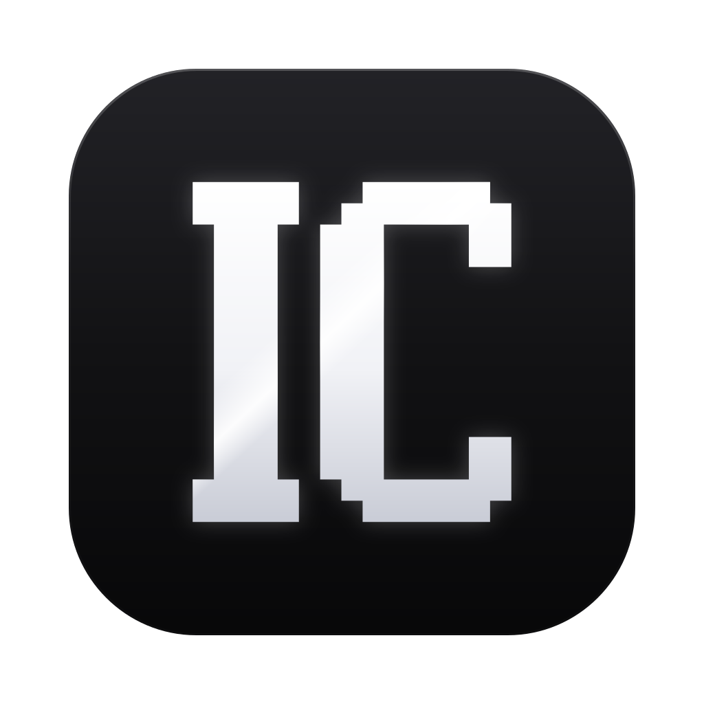

<p align="center">
  
</p>

<h1 align="center">Israel Code</h1>

<p align="center">
  <a href="https://github.com/EnzoWasTaken/israelcode/releases/latest"></a>
  <a href="LICENSE"></a>
</p>

Israel Code is a desktop coding agent that works directly in your codebase with the AI subscription you already pay for.

It is a modified version of [GG Coder](https://github.com/KenKaiii/gg-framework) by Ken Kai, released under the same AGPL-3.0 license. This fork stays linked to upstream so improvements there can still be merged in.

## Features

- **Code, Chat and Motion:** a coding agent for your projects, conversations that remember context, and Israel Motion for turning ideas into videos.
- **Israel Goals:** hand over a whole goal; a team of workers sees it through.
- **Israel Autopilot:** after each run, Israel reviews the work and keeps it going until it is actually verified.
- **Ship it properly:** one-click checks for security, compliance, data safety, accessibility and tests, plus a Project health score.
- **Your subscriptions:** Claude, ChatGPT, Gemini, Grok, Kimi, API keys or local models.
- **Project colour tags:** give each open project its own colour, with an optional header stripe.
- **A branch per window:** windows that share a folder can each work on their own branch, using worktrees.
- **Task list:** for bigger jobs the agent keeps a live checklist under your message, pinned above the composer while it works.
- **Ultracode:** switch it on (or type "ultracode" in a message) and big jobs are split into phases, built by parallel agents, checked by a reviewer and combined, with the phases shown live.
- **Dictation:** a mic button in the composer (`Ctrl+Shift+Space`) transcribes offline on your computer with Whisper.
- **Rewind:** go back to just before any message, undoing its file changes, the conversation or both (`Esc Esc`, `/rewind`, or the button beside a message).
- **Permission modes:** Ask, Accept edits, Plan or Bypass from the composer pill (`Shift+Tab`); held edits and commands show an approval card.
- **Diff review:** each turn ends with what it changed on disk, file by file, with Revert per file or for all.
- **Claude Code skills and plugins:** skills in `~/.claude/skills` and `.claude/skills`, and the plugins you installed in Claude Code (their skills, commands, agents and MCP servers), load here too.

## Get started

1. Install Israel Code:

   **macOS, Windows and Linux:** [download the latest release](https://github.com/EnzoWasTaken/israelcode/releases/latest) when one is published.

   **From source:** with Node.js, pnpm and the [Tauri prerequisites](https://v2.tauri.app/start/prerequisites/) installed:

   ```bash
   git clone https://github.com/EnzoWasTaken/israelcode.git
   cd israelcode
   pnpm install
   pnpm build
   pnpm --filter gg-app tauri dev
   ```

2. Open the app, connect your AI provider, and pick Code, Chat or Motion.

Israel Code keeps its settings, logins and sessions in `~/.israelcode`, so it can be installed beside GG Coder (which uses `~/.gg`) without the two sharing data. Project folders keep using `.gg/` for project-level config such as `.gg/mcp.json`, `.gg/commands` and `.gg/plans`.

## Online features hosted upstream

- **GG World** (the in-app multiplayer world) and **Agent Home** (the CLI remote relay) connect to servers run by the upstream author. Both are opt-in. See [GG-WORLD-PRIVACY.md](GG-WORLD-PRIVACY.md) for what GG World sends.
- The CLI's npm auto-update is off, because Israel Code is not published to npm and an update would install upstream GG Coder over it. Set `ISRAELCODE_NPM_AUTO_UPDATE=1` to turn it back on.

## Releases

Desktop releases are built by `.github/workflows/release.yml` on a `v*` tag. Signing is your own: add `TAURI_SIGNING_PRIVATE_KEY` and `TAURI_SIGNING_PRIVATE_KEY_PASSWORD` (a [minisign key from `tauri signer generate`](https://v2.tauri.app/plugin/updater/#signing-updates)) as repository secrets and put the matching public key in `plugins.updater.pubkey` in `gg-app/src-tauri/tauri.conf.json`. macOS and Windows code-signing secrets are listed at the top of `release.yml`. Until those are set the release workflow fails closed and the in-app updater installs nothing.

## Build with the framework

The engine packages keep their upstream npm names, so upstream merges stay easy:

- [**@kenkaiiii/gg-ai**](packages/gg-ai/README.md): connect to AI providers and stream responses.
- [**@kenkaiiii/gg-agent**](packages/gg-agent/README.md): build agents that use your tools and work through tasks.
- [**@kenkaiiii/gg-core**](packages/gg-core/README.md): model selection, authentication and local model discovery.
- [**@kenkaiiii/ggcoder**](packages/ggcoder/README.md): the coding agent, sessions and tools behind the app and CLI.

## License

AGPL-3.0-only. See [LICENSE](LICENSE) and [NOTICE](NOTICE). If you distribute your changes or run them as a network service, you share their source under the same license.

## Contributing

Bug reports, ideas and pull requests are welcome. Read [CONTRIBUTING.md](CONTRIBUTING.md) and the [Code of Conduct](CODE_OF_CONDUCT.md) before you start.
